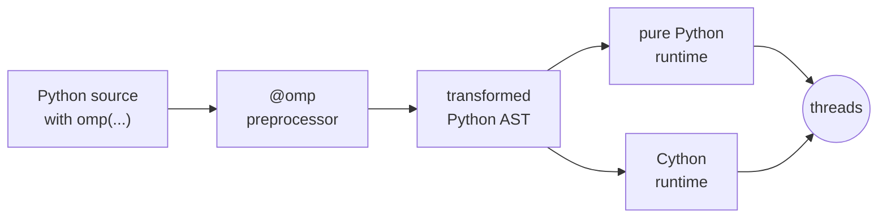

<div align="center">


<br>

**OpenMP for Python, written as Python.**<br>
Parallelize loops and code sections with the OpenMP syntax you already know, on free-threaded Python.

[](https://www.python.org/)
[](https://docs.python.org/3/howto/free-threading-python.html)
[](LICENSE)
[](https://omp4py.readthedocs.io)
[](https://doi.org/10.1109/CGO68049.2026.11395224)

[Documentation](https://omp4py.readthedocs.io) ·
[Getting started](https://omp4py.readthedocs.io/en/latest/getting_started/index.html) ·
[Tutorials](https://omp4py.readthedocs.io/en/latest/tutorials/index.html) ·
[Examples](examples) ·
[FAQ](https://omp4py.readthedocs.io/en/latest/faq.html)

</div>

> **Citing OMP4Py.** If you use it in your research, please cite:
> 1. César Piñeiro and Juan C. Pichel, [*Unlocking Python Multithreading Capabilities using OpenMP-Based Programming with OMP4Py*](https://doi.org/10.1109/CGO68049.2026.11395224), IEEE/ACM International Symposium on Code Generation and Optimization (CGO), 2026.
> 2. César Piñeiro and Juan C. Pichel, [*OMP4Py: A pure Python implementation of OpenMP*](https://doi.org/10.1016/j.future.2025.108035), Future Generation Computer Systems, Vol. 175, 2026.

## Quick look

```python
from omp4py import *

@omp
def pi(n):
    total = 0.0
    with omp("parallel for reduction(+:total)"):
        for i in range(n):
            x = (i + 0.5) / n
            total += 4.0 / (1.0 + x * x)
    return total / n

print(pi(10_000_000))     # 3.141592653589...
```

The body of the region is **ordinary Python**: no new language and no Numba-style restrictions.
Use any function, library or object, and run it on all your cores.

## Why OMP4Py?

- **Real OpenMP syntax.** Parallel regions, worksharing loops and sections, synchronization, data-sharing clauses, schedules and reductions. OpenMP 6.0 names such as `parallel masked` are accepted.
- **Any Python code.** NumPy, your own classes, any library, inside a parallel region.
- **Dual runtime.** A pure Python runtime and a native one compiled with Cython.
- **Four execution modes.** From "it just runs" to near-C speed, with the same code.
- **Cluster ready.** Combine it with [mpi4py](https://github.com/mpi4py/mpi4py) for intra-node and inter-node parallelism.
- **Extensible.** Add your own devices, directives and modifiers.

Unlike the Numba-based [PyOMP](https://github.com/Python-for-HPC/PyOMP), OMP4Py does not restrict the Python you can write inside a region.

## Install

```bash
pip install git+https://github.com/citiususc/omp4py.git@openmp-4.5
```

> [!NOTE]
> This installs the **`openmp-4.5` branch**, the latest code, which is where the OpenMP 4.5 work
> lives. The package **will be published on PyPI with the first release**; until then, install it
> from GitHub as shown above.

Requires **Python 3.13+**. Programs are correct on any build, but real multithreaded speed-ups need a
**free-threaded** build; **Python 3.15** is recommended. With [uv](https://docs.astral.sh/uv/getting-started/installation/):

```bash
uv run -p 3.15+freethreaded python your_file.py
```

## One program, four modes

| Mode | How | Result |
| --- | --- | --- |
| **Pure** | `OMP4PY_PURE=1` | Pure Python runtime |
| **Hybrid** (default) | `from omp4py import *` | Compiled runtime, Python code |
| **Compiled** | `@omp(compile=True)` | Runtime and function in native code |
| **Compiled + types** | `@omp(compile=True)` and annotations | Fastest: Cython uses static types |

More in [the execution modes guide](https://omp4py.readthedocs.io/en/latest/user_guide/execution_modes.html).

## More examples

**Balance uneven work.** Rows of a Mandelbrot image cost very different amounts, so hand them out on demand with `schedule(dynamic)`:

```python
@omp
def mandelbrot(width, height, max_iter=200):
    image = [[0] * width for _ in range(height)]
    with omp("parallel for schedule(dynamic)"):
        for y in range(height):
            for x in range(width):
                c = complex(-2.0 + 3.0 * x / width, -1.0 + 2.0 * y / height)
                z, n = 0j, 0
                while n < max_iter and abs(z) <= 2.0:
                    z = z * z + c
                    n += 1
                image[y][x] = n
    return image
```

**Define your own reduction.** `declare reduction` teaches OpenMP how to combine any Python object; here, the longest Collatz chain, as a (length, starting number) pair:

```python
@omp
def longest_collatz(limit):
    omp("declare reduction(best : tuple) "
        "combiner(omp_out = omp_in if omp_in[0] > omp_out[0] else omp_out) "
        "initializer(omp_priv = (0, 0))")

    best: tuple = (0, 0)
    with omp("parallel for reduction(best:best) schedule(dynamic, 500)"):
        for start in range(1, limit):
            n, steps = start, 0
            while n != 1:
                n = n // 2 if n % 2 == 0 else 3 * n + 1
                steps += 1
            if steps > best[0]:
                best = (steps, start)
    return best                         # longest_collatz(60_000) -> (339, 52527)
```

**Combine directives, the OpenMP 6.0 way.** One line can stand for several nested constructs, and a *directive-name modifier* chooses which of them receives a clause. Here a Fibonacci with tasks (tasking is still under development, see [Status](#status)):

```python
@omp
def fib(n):
    if n < 2:
        return n
    x = y = 0
    with omp("task shared(x) if(n > 20)"):          # small calls run inline: no task overhead
        x = fib(n - 1)
    y = fib(n - 2)
    omp("taskwait")
    return x + y

@omp
def run(n):
    result = 0
    # parallel + masked + task in one line: one thread creates the root task,
    # and `if(task: ...)` applies to the task, not to the parallel region
    with omp("parallel masked task shared(result) if(task: n > 15) num_threads(8)"):
        result = fib(n)
    return result
```

Nesting works the same way. With `masked parallel`, only thread 0 of the outer team opens a nested team:

```python
with omp("parallel num_threads(4)"):
    with omp("masked parallel for num_threads(2) reduction(+:total)"):    # only thread 0 gets here
        for i in range(n):
            total += i
```

**Ask the runtime.** The standard routines are there: `omp_get_thread_num()`, `omp_get_num_threads()`, `omp_set_num_threads()`, `omp_get_schedule()`...

## Ship it in a library

Process your package once, when you build it, and distribute the result, in the same way that `setup.py` files call `cythonize(...)`:

```python
# setup.py
from omp4py import omp

omp(py="mypkg/kernels.py")      # writes the processed module into mypkg/__omp__/
```

Or enable a whole package from its `__init__.py` with `omp(pkg=__package__)`. See
[Distributing libraries](https://omp4py.readthedocs.io/en/latest/user_guide/decorator/files.html).

## See what it generates

Nothing is hidden. `@omp(dump="pi_transformed.py")` writes the Python that really runs: each
region becomes a nested function, each loop a `while` over chunks handed out by the runtime, and each
reduction a private copy merged at the end.

```python
@omp(dump="pi_transformed.py")
def pi(n): ...
```

More in [Debugging and common pitfalls](https://omp4py.readthedocs.io/en/latest/user_guide/debugging.html).

## How it works



`@omp` rewrites the decorated code at import time, replacing each directive by calls to the runtime.
Nothing changes in the code you debug and test.

## Extend it

The `omp4py.core.ext` API lets you add **new directives** (subparsers), **new code generators**
(devices) and **code modifiers**, and load them lazily with `omp(extension="my_module")`. See the
[extensions guide](https://omp4py.readthedocs.io/en/latest/contributor/extensions/index.html).

## Status

OMP4Py is moving from OpenMP 3.0 to the full **OpenMP 4.5**. Parallel regions, worksharing,
synchronization, data-sharing and runtime routines work today. `task` (with `depend`) and `target`
are **under development**; see the
[coverage page](https://omp4py.readthedocs.io/en/latest/compatibility/coverage.html).

## Documentation

The full documentation is at [omp4py.readthedocs.io](https://omp4py.readthedocs.io). A map of it:

- **Start here:** [Installation](https://omp4py.readthedocs.io/en/latest/getting_started/installation.html), [Quick start](https://omp4py.readthedocs.io/en/latest/getting_started/quickstart.html) and [Core concepts](https://omp4py.readthedocs.io/en/latest/getting_started/concepts.html).
- **Write parallel code:** [Directives](https://omp4py.readthedocs.io/en/latest/user_guide/directives.html), [Clauses](https://omp4py.readthedocs.io/en/latest/user_guide/clauses.html), [Combined directives](https://omp4py.readthedocs.io/en/latest/user_guide/combined_directives.html), [Runtime routines](https://omp4py.readthedocs.io/en/latest/user_guide/runtime_api.html) and [Environment variables](https://omp4py.readthedocs.io/en/latest/user_guide/environment.html).
- **Go faster:** [Execution modes](https://omp4py.readthedocs.io/en/latest/user_guide/execution_modes.html), [Compiled mode](https://omp4py.readthedocs.io/en/latest/user_guide/compiled_mode.html) and [Performance](https://omp4py.readthedocs.io/en/latest/user_guide/performance.html).
- **Learn by example:** [π](https://omp4py.readthedocs.io/en/latest/tutorials/pi.html), [matrix multiplication](https://omp4py.readthedocs.io/en/latest/tutorials/matmul.html), [word histogram](https://omp4py.readthedocs.io/en/latest/tutorials/histogram.html) and [NumPy rows](https://omp4py.readthedocs.io/en/latest/tutorials/numpy.html).
- **Understand and extend it:** [Architecture](https://omp4py.readthedocs.io/en/latest/contributor/architecture.html), [Adding a directive](https://omp4py.readthedocs.io/en/latest/contributor/adding_directive.html) and the [Extensions](https://omp4py.readthedocs.io/en/latest/contributor/extensions/index.html) API.
- **Reference:** [OpenMP 4.5 coverage](https://omp4py.readthedocs.io/en/latest/compatibility/coverage.html), [FAQ](https://omp4py.readthedocs.io/en/latest/faq.html) and [Changelog](https://omp4py.readthedocs.io/en/latest/changelog.html).

## Contributing

Contributions, bug reports and ideas are welcome. The
[contributor guide](https://omp4py.readthedocs.io/en/latest/contributor/index.html) explains how the
project is organised, how to set up the development environment and run the tests, and how to add new
directives, devices and extensions.
